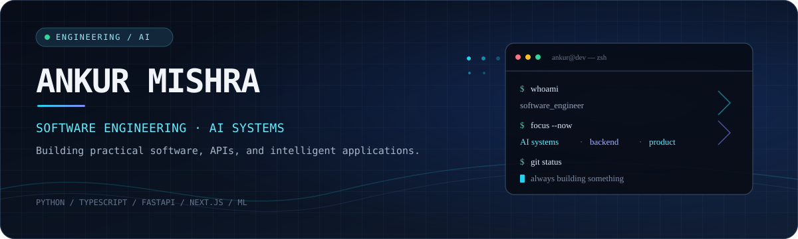

<!--
  Ankur Mishra | Software Engineering · AI Systems · Full-stack Development
-->

<p align="center">
  
</p>

<p align="center">
  <a href="https://github.com/Ankur0191?tab=repositories"></a>
  <a href="https://www.linkedin.com/in/ankur-mishra/"></a>
  
</p>

---

## `~/about`

I'm Ankur — a software engineer interested in the systems behind useful products: APIs, data pipelines, applied machine learning, and thoughtful interfaces.

I like working across the stack, from shaping a problem and designing its architecture to integrating services, debugging edge cases, and polishing the experience people actually use.

```bash
ankur@github:~$ whoami
software engineer | AI systems | full-stack development

ankur@github:~$ areas --active
applied-LLMs  backend-APIs  data-products  developer-tools

ankur@github:~$ principle
build it clearly • test the assumptions • ship the useful thing
```

## `~/selected-work`

<table>
  <tr>
    <td width="50%" valign="top">
      <h3><a href="https://github.com/Ankur0191/payments-fraud-detection">01 / FraudShield</a></h3>
      <p>A fraud-risk dashboard prototype combining a web interface with a Python API.</p>
      <p><code>Next.js</code> <code>Material UI</code> <code>FastAPI</code> <code>MongoDB</code></p>
      <sub>Current repository notes: transaction data is mocked; model integration is a planned next step.</sub>
    </td>
    <td width="50%" valign="top">
      <h3><a href="https://github.com/Ankur0191/ai-infra-analyzer_for_business">02 / AI Infra Copilot</a></h3>
      <p>An AI-task and infrastructure workflow project with a Python API and a lightweight operational UI.</p>
      <p><code>Python</code> <code>FastAPI</code> <code>Uvicorn</code> <code>Streamlit</code></p>
    </td>
  </tr>
</table>

<p align="right"><a href="https://github.com/Ankur0191?tab=repositories">More repositories ↗</a></p>

## `~/toolchain`

**Languages**


**Web & backend**


**AI / ML**


**Data & delivery**


## `~/engineering-notes`

- **AI in production:** useful workflows, evaluation, integration, and the gap between a demo and a dependable feature.
- **Backend quality:** clear API contracts, authentication, validation, failure handling, and maintainable services.
- **Data-rich products:** turning noisy data into information that is easier to understand and act on.
- **Developer experience:** interfaces and tooling that make complex work feel simpler.

## `~/github --stats`

<p align="center">
  
  
</p>

<p align="center">
  
</p>

---

<p align="center">
  <sub>Less noise. Better systems. Useful software.</sub>
</p>
